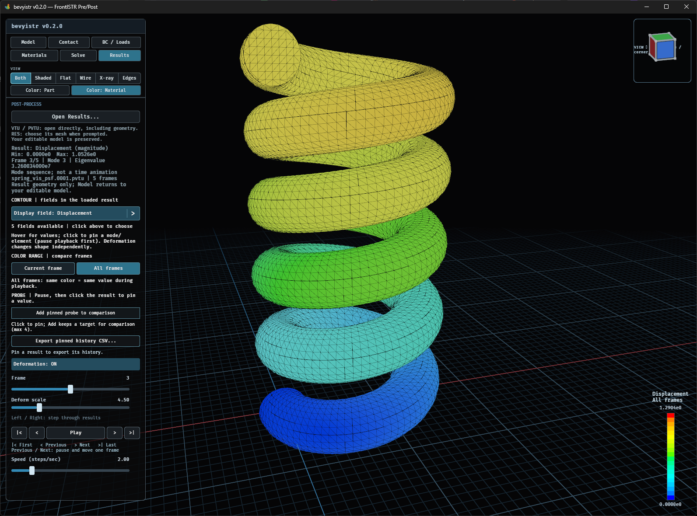

# 連番とアニメーション

次のような出力を番号順の系列として検出します。

```text
hinge_vis_psf.0000.pvtu
hinge_vis_psf.0001.pvtu

beam.res.0.0
beam.res.0.5000
beam.res.0.10000

fstrRES/STEP0/conrod.res.0.0
fstrRES/STEP1/conrod.res.0.1
```

- 開いたファイルに対応するステップから表示を始めます。
- **Frame**は読み込んだ系列の表示順で、1から始まります。
- シークバーの**Frame 3 / 120**は「全120コマ中の3コマ目」です。クリック／ドラッグすると再生を停止し、選択したコマへ移動します。再生ボタンはバーの直下に配置しています。
- **Step**はファイル側の出力番号です。Frame 2がStep 5000に対応する場合もあります。
- **Time**は結果に記録された時刻です。時刻情報がない場合は現在の実装では0になります。
- **Play／Pause**で再生・停止します。**<（Previous）／>（Next）**は1コマ戻し／送り、**|<（First）／>|（Last）**は先頭／末尾への移動です。`>|`は「次」ではなく「最後」です。
- これらの移動ボタンを押すと再生を停止し、指定フレームを表示します。前後移動は端で止まり、Playは末尾から先頭へループします。結果が1フレームだけの場合は再生・移動を無効にします。
- 0.3.0向け開発版では、Resultsの**左／右矢印キー**も再生を停止して1コマ移動します。数値入力中・ポップアップ表示中・他のページではコマ送りしません。
- 再生速度はフレーム毎秒です。物理時刻の差に比例した再生ではありません。速度欄にも **not physical-time playback** と表示します。
- ワイヤ表示も、変形ON/OFF、倍率変更、フレーム移動に追従します。

FrontISTRのピースVTUを直接選んだ場合は、そのファイルを参照するPVTUが見つかればPVTUの系列を使用します。MPIランク番号は時系列の番号として扱いません。

## 固有値解析（開発版・0.3.0向け）

RESのグローバルデータ／VTU・PVTUの`FieldData`に`EIGENVALUE`がある場合は、
**Timeの代わりにModeとEigenvalue**を表示します。Frameは読み込み順、Modeは元の出力番号です。
シークバーは**Mode (order) 3 / 5**のように、読み込んだモードの何番目かと総数を示します。
バー下に **Order above; original mode below** と案内し、元のモード番号はその下の**Mode**に表示します。例えば番号が1・3・7の3モードなら、
末尾の位置は`3 / 3`、元番号は`Mode 7`であり、7コマあるとは扱いません。
`15_eigen_spring`では5ファイルがMode 1〜5に対応します。
固有値はファイルの値を保持し、単位や周波数（Hz）へ推測で換算しません。
グローバルな値なので、空間分布を示すコンターメニューには追加しません。

Playはモード間の切り替えであり、単一モードを往復振動させるアニメーションではありません。
速度欄は **Speed (modes/sec)** に切り替わり、**switches modes, not vibration** と表示します。
HISTORYは**Mode/frame sequence (not time)**として読み込み順に表示します。
固定プローブのCSVでもモード・固有値を別列に保存し、時刻欄は空欄にします。
`EIGENVALUE`がない結果を、ファイル名だけから固有値解析と推測することはありません。
このメタデータ表示は公開済みv0.2.0には含まれません。



表示例：Frame 3/5、Mode 3、Eigenvalue `3.260034e7`。
変位の大きさをコンター表示し、All framesの色範囲、変形倍率4.50を使用しています。
画面の版番号は開発時点の0.2.0ですが、モード表示は0.3.0向けの機能です。
この画像ではプローブはまだ固定していないため、HISTORYは表示されていません。

熱・流体の結果で変位フィールドが出力されていなければ、Deformationは利用できません。
読み込んだ温度・圧力・速度などのフィールドをコンターとして選択してください。

色の範囲を固定して比較する方法は[コンターと変形](contours.md)を参照してください。
